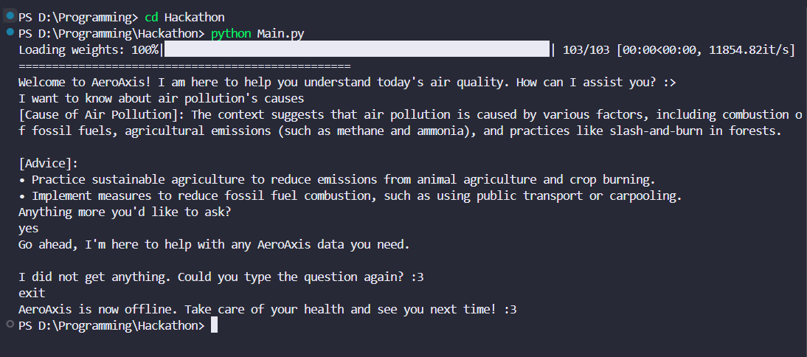
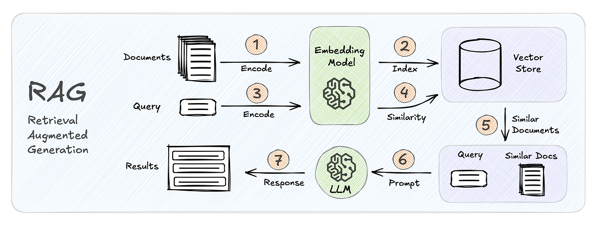
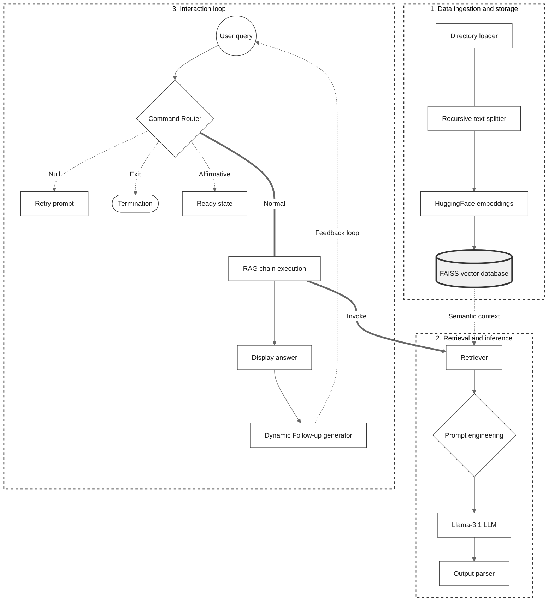

# Table of contents
[1. Introduction](#1-introduction)  
[2. Instructions](#2-setup-instructions)  
[3. Learning](#3-learning)  


# Project structure
```
Project/
├── Main.py             
├── Config.py            # Prompt templates, messages
├── .env                 # Environment variables (optional and private)
│
├── Knowledge base/      # Dataset
    ├── document1.txt
    ├── document2.txt
    └── ...

```
# 1. Introduction 
This project demonstrates LLM set-up, knowledge base for AI explaination and recommendation on AeroAxis - an interactive air quality mapping system for Ha Noi.  
This project is inspired by Asian Hackathon for Green Future 2026 with key challenge is urban air quality and climate resilience.  

The model generates responses using RAG technique.  
As a prototype, the system may have limitations such as potential biases, occasional errors, and higher computational requirements.


# 2. Instruction
Download Ollama on your computer.   
``` bash
irm https://ollama.com/install.ps1 | iex
```
Pull model.
``` bash
ollama pull llama3.1
```
Run model.  
``` bash
Ollama run llama3.1
```
Install pips.
``` bash
pip install langchain langchain-community langchain-core langchain-text-splitters langchain-huggingface langchain-ollama sentence-transformers faiss-cpu python-dotenv unstructured
```  
Warning: Do not change path, order, code, name, file,... of the project if you feel unsure about what you are doing. 
# 3. Learning
## 3.1. What is RAG?
Retrieval augmented generation (RAG) is a technique enhancing AI by incorporating information retrieval capabilities. With RAG, LLMs first refer to a specified set of documents called knowledge base, then respond to user queries. This allows LLMs to use domain-specific training data for personal usage.  

For example, AeroAxis LLM will access documents about air pollution, AQI, suggestion and generate response based on provided documents.


## 3.2. How RAG works?

## 3.3. RAG in AeroAxis

### 3.3.1. Data ingestion and storage
Directory loader: Load documents.
``` python
loader = DirectoryLoader(
    path = "./Knowledge base",
    glob = "**/*.txt", 
    loader_cls = TextLoader, 
    show_progress = True,
    loader_kwargs = {"encoding": "utf-8"},
    use_multithreading = True,
    silent_errors = True,
)
docs = loader.load()
```
+ Path: LLM get access to knowledge base.
+ Glob: Read all files with file extension .txt.
+ Loader_cls: Load all files txt.
+ Show_progress: Track loading progress.
+ Loader_kwargs: Detect file encoding. 
+ Use_multithreading: Parallelize loading.
+ Silent_errors: Skip error files.  

Text splitter: Chunking.
``` python
text_splitter = RecursiveCharacterTextSplitter(
    chunk_size = 500,
    chunk_overlap = 100,
    add_start_index = True,
    strip_whitespace = True,
    separators = ["\n\n", "\n", " ", ""]
)
splits = text_splitter.split_documents(docs)
```
+ Chunk_size: The size of the chunk.
+ chunk_overlap: The overlap-range of the chunk.
+ Add_start_index: Save position in documents.
+ Strip_whitespace: Avoid whitespace.
+ Separators: The order of priority.

Embeddings: Change chunks to vector.
``` python
embeddings = HuggingFaceEmbeddings(
    model_name = "all-MiniLM-L6-v2",
    encode_kwargs = {'normalize_embeddings': True} 
)
```
+ Model_name: Model name.
+ Encode_kwargs: Normalize vector.

FAISS vector database: Store vectors.
``` python
vector_database = FAISS.from_documents(
    # inputs
    # Begin
    documents = splits,
    embedding = embeddings,
    # End
    distance_strategy = DistanceStrategy.COSINE
)
```
+ Distance_strategy: Calculate the angle between two vector. 

### 3.3.2. Retrieval and inference
Retriever: Change vector database to retriever for RAG.
``` python
retriever = vector_database.as_retriever(
    search_type = "similarity_score_threshold", 
    search_kwargs = {"k": 5, "score_threshold": 0.7}    
)
```
+ Search_type: Find similar vectors with threshold.
+ Search_kwargs: How many documents you want and threshold. 

Prompt engineering: Enhance responses.
``` python
prompt = ChatPromptTemplate.from_template(Config.template)
```
+ Get access to prompt template.

LLM: 
``` python
LLM = ChatOllama(
    model = "llama3.1",
    temperature = 0,
)
```
+ Model: Model.
+ Temperature: No random.  
