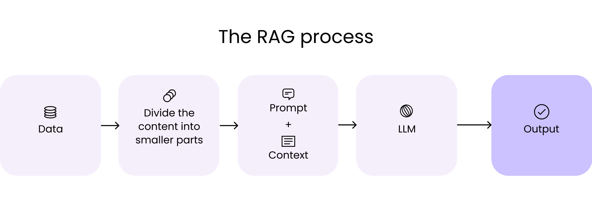
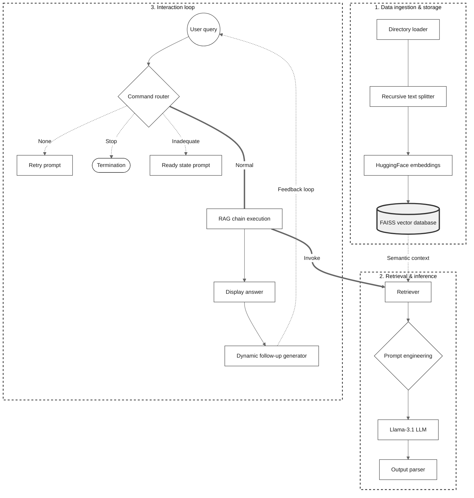

# AeroAxis: Autonomous air quality mapping in Vietnam.


# Table of contents
+ [1. Introduction](#1-introduction)
+ [2. Project structure](#2-project-structure)
+ [3. Setup instructions](#3-setup-instructions)
+ [4. Learning & architecture](#4-learning--architecture)

---

# 1. Introduction 
This project demonstrates an LLM set-up, knowledge base for AI explaination and recommendation on **AeroAxis** - an interactive air quality mapping system for Ha Noi.

This project is inspired by **Asian Hackathon for Green Future 2026** with key challenge is urban air quality and climate resilience.  

The model generates responses using **RAG** technique. 

> **Disclaimer:** As a prototype, the system may have limitations such as potential biases, occasional errors, and higher computational requirements for local execution.


---

# 2. Project structure
```text
AeroAxis/
├── Main.py              # Core execution logic and RAG pipeline
├── Config.py            # Prompt templates, strict rules, and system messages
├── .env                 # Environment variables (optional and private)
│
├── Knowledge base/      # Dataset containing domain-specific context
    ├── document1.txt
    ├── document2.txt
    └── ...
```

---

# 3. Setup instructions
Download and install Ollama on your computer to run the local LLM. 
``` bash
irm https://ollama.com/install.ps1 | iex
```
Pull the model (llama3.1) into your local environment.
``` bash
ollama pull llama3.1
```
Install the required Python libraries.
``` bash
pip install langchain langchain-community langchain-core langchain-text-splitters langchain-huggingface langchain-ollama sentence-transformers faiss-cpu python-dotenv unstructured
```   
Make sure the Ollama service is running in the background, then execute the main script.
``` bash
Ollama run llama3.1
```
> **Warning**: Do not change path, order, code, name, file,... of the project if you feel unsure about what you are doing.  
**Note:** Check **Config.py** for commands.

---

# 4. Learning & architecture
## 4.1. What is RAG?
Retrieval augmented generation (RAG) is a technique enhancing AI by incorporating information retrieval capabilities. With RAG, LLMs first refer to a specified set of documents called knowledge base, then respond to user queries. This allows LLMs to use domain-specific training data for personal usage.  

For example, AeroAxis LLM will access documents about air pollution, AQI, suggestion and generate response based on provided documents.


## 4.2. How RAG works?

## 4.3. RAG pipeline in AeroAxis

### 4.3.1. Data ingestion & storage
Directory loader: Load documents.
``` python
loader = DirectoryLoader(
    path = "./Knowledge base",
    glob = "**/*.txt", 
    loader_cls = TextLoader, 
    show_progress = True,
    loader_kwargs = {"encoding": "utf-8"},
    use_multithreading = True,
    silent_errors = True,
)
docs = loader.load()
```
+ Path: LLM get access to knowledge base.
+ Glob: Read all files with file extension .txt.
+ Loader_cls: Load all files txt.
+ Show_progress: Track loading progress.
+ Loader_kwargs: Detect file encoding. 
+ Use_multithreading: Parallelize loading.
+ Silent_errors: Skip error files.  

Text splitter: Chunking.
``` python
text_splitter = RecursiveCharacterTextSplitter(
    chunk_size = 500,
    chunk_overlap = 100,
    add_start_index = True,
    strip_whitespace = True,
    separators = ["\n\n", "\n", " ", ""]
)
splits = text_splitter.split_documents(docs)
```
+ Chunk_size: The size of the chunk.
+ Chunk_overlap: Overlap amount to preserve context between chunks.
+ Add_start_index: Save position in documents.
+ Strip_whitespace: Avoid whitespace.
+ Separators: The order of priority in chunking.

Embeddings: Change chunks to vector.
``` python
embeddings = HuggingFaceEmbeddings(
    model_name = "all-MiniLM-L6-v2",
    encode_kwargs = {'normalize_embeddings': True} 
)
```
+ Model_name: Model name.
+ Encode_kwargs: Normalize vector.

FAISS vector database: Store vectors.
``` python
vector_database = FAISS.from_documents(
    # inputs
    # Begin
    documents = splits,
    embedding = embeddings,
    # End
    distance_strategy = DistanceStrategy.COSINE
)
```
+ Distance_strategy: Calculate the angle between two vector. 

### 4.3.2. Retrieval and inference
Retriever: Change vector database to retriever for RAG.
``` python
retriever = vector_database.as_retriever(
    search_type = "similarity", 
    search_kwargs = {"k": 5}    
)
```
+ Search_type: Find similar vectors.
+ Search_kwargs: How many documents you want.

Prompt engineering: Enhance responses.
``` python
prompt = ChatPromptTemplate.from_template(Config.template)
```
+ Get access to prompt template.

LLM configuration: Instantiates the local llama 3.1 model.
``` python
LLM = ChatOllama(
    model = "llama3.1",
    temperature = 0,
    top_p = 0.9,
    num_predict = 512,
    repeat_penalty = 1.1
)
```
+ Model: Model.
+ Temperature: Enforces maximum strictness and factual accuracy.
+ top_p: Nucleus sampling to filter out highly improbable vocabulary.  
+ num_predict: Output length limit.
+ repeat_penalty: Prevents the model from looping or repeating phrases.
